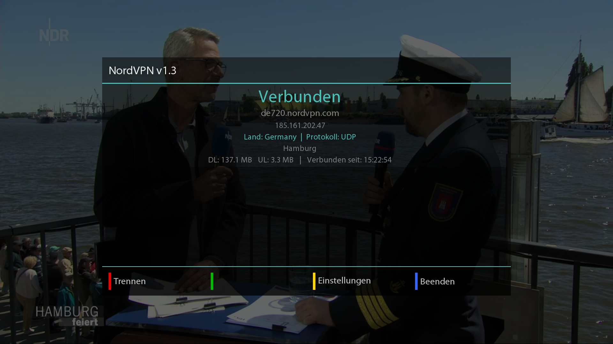
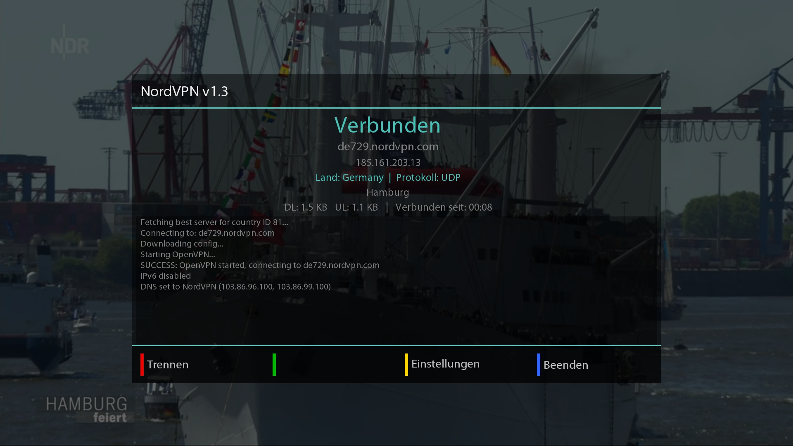
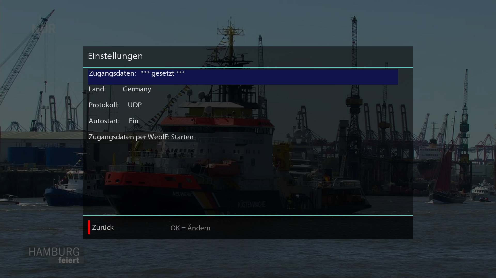
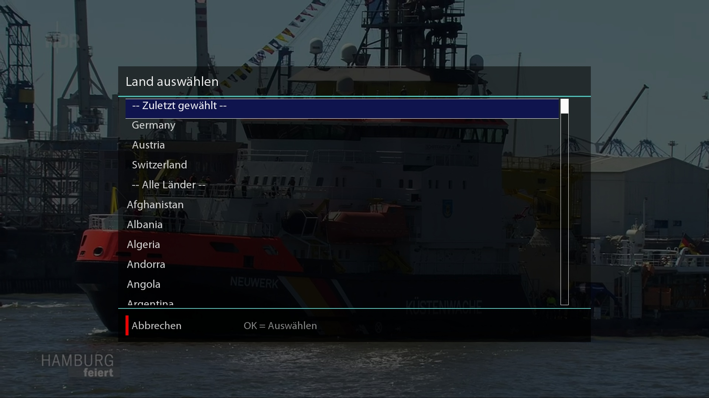
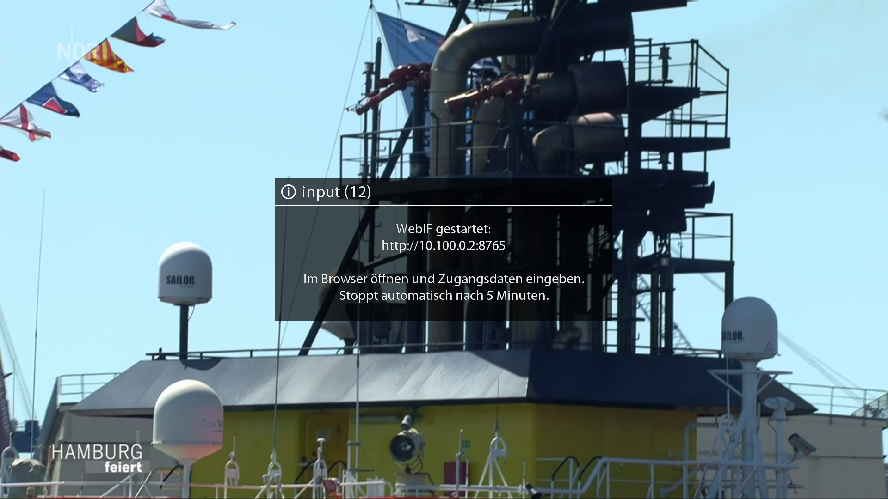
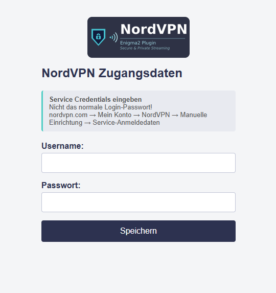

# NordVPN Plugin für Enigma2 (VTi und openATV)

OpenVPN-basierter NordVPN-Client für Enigma2-Receiver mit VTi- oder openATV-Image.

Entwickelt und getestet auf VU+-Receivern mit VTi 15, VTi 16, openATV 7.6 und openATV 8.0. Eine IPK für beide Images (Python 2 und Python 3).

Dieses Projekt steht unter der [GNU General Public License v2.0](LICENSE).

---

## Screenshots

<table>
  <tr>
    <td></td>
    <td></td>
  </tr>
  <tr>
    <td></td>
    <td></td>
  </tr>
  <tr>
    <td></td>
    <td></td>
  </tr>
</table>

---

## Funktionen

- Verbindung zum besten verfügbaren NordVPN-Server im gewählten Land
- Automatische Serverwahl über die offizielle NordVPN-API
- **Automatisches Überspringen kaputter Server** – lehnt ein von der API empfohlener Server die Zugangsdaten ab, probiert das Plugin selbstständig den nächsten Kandidaten, statt mit einer irreführenden Fehlermeldung aufzugeben
- Unterstützung für **UDP** und **TCP**
- **P2P-Server** wählbar (Server-Typ Standard oder P2P)
- **DNS-Leak-Schutz** – der gewählte DNS-Server (NordVPN, Google oder Cloudflare) wird beim Verbinden gesetzt und der eigene DNS beim Trennen wiederhergestellt
- **IPv6-Leak-Schutz** – IPv6 wird für die Dauer der VPN-Verbindung deaktiviert; beim Trennen gilt wieder die Netzwerkeinstellung des Images (z. B. „Nur IPv4“ unter openATV)
- **Watchdog-Daemon** – erkennt abgestürzte Verbindungen und reconnectet automatisch (in den ersten 2 Minuten nach einem Verbindungsversuch alle 10 Sekunden, danach alle 60 Sekunden); merkt sich dabei kaputte Server und meidet sie bei künftigen automatischen Reconnects
- **OSD-Benachrichtigungen** bei Verbindungsauf- und -abbau (nur wenn das Plugin geschlossen ist); die Getrennt-Meldung enthält einen Hinweis auf den automatischen Reconnect
- **Nächster Server** – bei bestehender Verbindung wechselt die Blaue Taste direkt zum nächstbesten Server der NordVPN-API (aktueller und bereits bekannte kaputte Server werden übersprungen)
- **Mediathek-Fix** – behebt Verbindungsfehler bei ARD (Event 2), ZDF, 3sat, ZDFinfo, ZDFneo, Phoenix und RBB durch Vorabauflösung der betroffenen Akamai-CDN-Hostnamen
- **Eigene OpenVPN-Config** – wer eine Dedicated-IP oder einen festen Server nutzen möchte, kann eine eigene `.ovpn`-Datei unter `/etc/openvpn/nordvpn_custom.ovpn` hinterlegen und in den Einstellungen aktivieren
- **Auto-Reconnect bei Einstellungsänderungen** – Land, Protokoll, Server-Typ, DNS oder Mediathek-Fix ändern verbindet automatisch neu; beim Durchschalten mehrerer Werte nur einmal mit dem zuletzt gewählten
- **Verbindungsaufbau abbrechen** – während das Plugin verbindet, bricht die Rote Taste den Vorgang ab
- **Autostart** beim Hochfahren der Box (optional)
- **Zuletzt gewählte Länder** werden oben in der Länderliste angezeigt

---

## Voraussetzungen

- VU+ Receiver mit **VTi 15, VTi 16 oder openATV**
- OpenVPN (wird bei der Installation als Abhängigkeit aus dem Image-Feed nachinstalliert, falls noch nicht vorhanden)
- Ein NordVPN-Konto mit **Service Credentials**

> **Wichtig:** Es werden nicht die normalen Login-Daten benötigt, sondern die manuellen Service Credentials.  
> Diese findest du unter: [nordvpn.com](https://nordvpn.com) → Mein Konto → NordVPN → Manuelle Einrichtung → **Service-Anmeldedaten**

---

## Installation

Die aktuelle IPK von der [Releases-Seite](../../releases/latest) herunterladen, per FTP nach `/tmp` auf die Box kopieren und per SSH installieren:

```sh
opkg install /tmp/enigma2-plugin-extensions-nordvpn_*_all.ipk
```

Das Plugin installiert sich vollständig – Berechtigungen werden automatisch gesetzt und der Watchdog-Daemon wird gestartet. Bei einem Update wird eine bestehende Verbindung getrennt, DNS und IPv6 werden wiederhergestellt; Zugangsdaten und Einstellungen bleiben erhalten.

Das Plugin erscheint nach einem Neustart von Enigma2 im Menü unter **Plugins → NordVPN**.

### Installierte Dateien

| Pfad | Beschreibung |
|------|--------------|
| `/usr/lib/enigma2/python/Plugins/Extensions/NordVPN/` | Plugin-Dateien |
| `/usr/sbin/nordvpn-connect` | Verbindungsaufbau |
| `/usr/sbin/nordvpn-disconnect` | Verbindungstrennung |
| `/usr/sbin/nordvpn-fetch-countries` | Länderliste von der NordVPN-API laden |
| `/usr/sbin/nordvpn-watchdog` | Hintergrunddaemon |
| `/usr/sbin/nordvpn-webif` | Weboberfläche zur Credential-Eingabe |

---

## Einrichtung

Das Plugin öffnen: **Menü → Plugins → NordVPN**

Dann **Gelb → Einstellungen**:

### 1. Zugangsdaten hinterlegen

Es gibt zwei Wege, die Credentials einzugeben:

**Über die Fernbedienung:** Einstellungen → **Zugangsdaten** → OK – Username und Passwort über die OSD-Tastatur eingeben.

**Über den Browser (WebIF):** Einstellungen → **WebIF starten** → OK – auf der Box startet ein temporärer Webserver. Die angezeigte Adresse im Browser öffnen und die Daten dort eingeben. Der Webserver stoppt automatisch nach 5 Minuten oder sobald die Daten gespeichert wurden.

Service Username und Service Passwort eingeben (nicht die normalen Login-Daten – siehe oben).  
Die Credentials werden im Klartext unter `/etc/openvpn/nordvpn_auth.txt` gespeichert (Berechtigungen: 600, nur für root lesbar).

### 2. Land auswählen

Einstellungen → **Land** → OK

Die Länderliste wird live von der NordVPN-API geladen. Zuletzt gewählte Länder erscheinen oben.  
Beim Verbinden wird automatisch der beste verfügbare Server im gewählten Land ausgewählt.

### 3. Protokoll wählen

Einstellungen → **Protokoll** → OK oder Links/Rechts

- **UDP** – Standard, schneller
- **TCP** – stabiler hinter restriktiven Firewalls

### 4. Autostart

Einstellungen → **Autostart** → OK oder Links/Rechts

Wenn aktiviert, verbindet das Plugin automatisch beim Starten der Box.

---

## Bedienung

| Taste | Funktion |
|-------|----------|
| Grün | Verbinden |
| Rot | Trennen (während des Verbindungsaufbaus: Abbrechen) |
| Gelb | Einstellungen |
| Blau | Nächster Server (nur bei aktiver Verbindung) |
| Exit / Back | Plugin schließen |

Das Hauptfenster zeigt: Verbindungsstatus, aktueller Server, externe IP, Land, Protokoll, DNS-Server, Stadt, Session-Traffic (DL/UL) und Verbindungsdauer – alles wird regelmäßig aktualisiert.

---

## Technische Details

### DNS-Leak-Schutz

Beim Verbinden wird der in den Einstellungen gewählte DNS-Server gesetzt (Standard: NordVPN mit `103.86.96.100` und `103.86.99.100`, alternativ Google oder Cloudflare) und die ursprüngliche Konfiguration gesichert. Beim Trennen wird sie automatisch wiederhergestellt.

### IPv6-Leak-Schutz

IPv6 wird für die Dauer der VPN-Verbindung systemweit deaktiviert. So kann kein Traffic an der VPN-Verbindung vorbeifließen. Beim Trennen wird IPv6 so gesetzt, wie es das Image beim Booten selbst tun würde – unter openATV bleibt IPv6 also aus, wenn in den Netzwerkeinstellungen „Nur IPv4“ aktiv ist.

### Watchdog

Der Watchdog-Daemon läuft im Hintergrund und prüft alle 60 Sekunden, ob der OpenVPN-Prozess noch aktiv ist. Ist er abgestürzt, wird automatisch eine neue Verbindung aufgebaut. Der Watchdog erkennt den VPN-Zustand zuverlässig auch nach einem Plugin- oder E2-Neustart.

Beim manuellen Trennen über das Plugin wird der Watchdog beendet – es erfolgt keine automatische Wiederverbindung.

---

## Deinstallation

```sh
opkg remove enigma2-plugin-extensions-nordvpn
```

Das Deinstallations-Skript räumt vollständig auf: Eine bestehende Verbindung wird getrennt, DNS und IPv6 werden wiederhergestellt, Watchdog und OpenVPN beendet, alle Konfigurations- und Logdateien gelöscht und die **Credentials entfernt**.

---

## Für Entwickler

### IPK neu bauen

```sh
python3 tools/build_ipk.py
```

Alle Quelldateien müssen im Projektordner vorhanden sein. Das fertige IPK wird im Projekt-Root abgelegt.

### Hinweise zur Kompatibilität

Der Code läuft unter Python 2.7 (VTi) und Python 3 (openATV) und nutzt die Enigma2-Python-API. Getestet wurde auf VTi 15, VTi 16, openATV 7.6 (Python 3.13) und openATV 8.0 (Python 3.14). Andere Enigma2-Images können funktionieren, sind aber nicht getestet.
